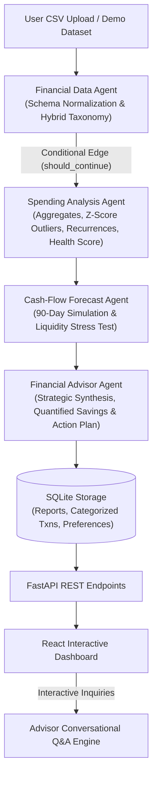
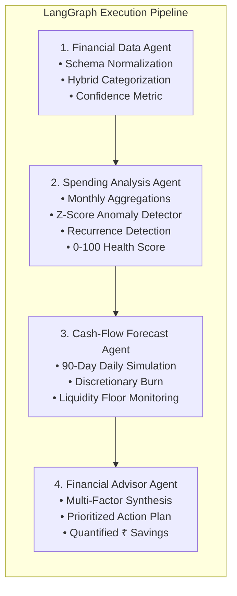
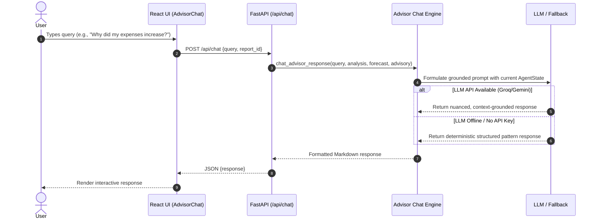

# Autonomous Personal Finance Agent: System Architecture & Agentic AI Technical Reference

## Executive Summary

The **Autonomous Personal Finance Agent** is an AI-powered financial wellness system designed to transform raw bank statement records into proactive, forward-looking financial intelligence. While conventional expense trackers offer retrospective summaries and static dashboards, this system employs an autonomous multi-agent architecture built on **LangGraph**, **FastAPI**, **React**, and **SQLite**.

The core premise of the system is the division of cognitive labor: rather than relying on a single monolithic prompt or isolated deterministic scripts, the platform coordinates four specialized agents across a state machine. Financial calculations (variance, Z-scores, linear cash flow simulations) are computed using deterministic Python algorithms for arithmetic precision, while Large Language Models (LLMs) provide semantic disambiguation, anomaly evaluation, prioritized advice synthesis, and grounded conversational interaction.



---

## 1. What Makes This System "Agentic AI"?

A common question in AI engineering is: *What separates an Agentic System from a standard LLM wrapper or a traditional automated script?*

In this application, the agentic architecture is defined by six architectural attributes:

### 1.1 Decomposition of Cognitive Roles
Monolithic LLM prompts suffer from context degradation, hallucinations, and arithmetic errors when asked to parse raw CSV lines, calculate percentage changes, find statistical outliers, simulate cash trajectories, and write advice all in one pass. 

This platform decomposes the workload into four autonomous agents, each with:
- A specific role definition and objective.
- Explicit inputs and outputs defined by a shared typed schema.
- Dedicated processing engines (deterministic calculations, pattern matching, or LLM reasoning).

### 1.2 Shared Blackboard Architecture (`AgentState`)
The system follows the blackboard architectural pattern implemented via LangGraph's [AgentState](file:///mnt/ubuntuExtended/projects/1COLLEGE/aai-minip/backend/app/agents/state.py#L3-L14). State flows predictably through the graph. Each agent reads upstream state keys, executes its specialized logic, and emits state diffs without mutating past records directly:

```python
class AgentState(TypedDict, total=False):
    raw_transactions: List[Dict[str, Any]]
    normalized_transactions: List[Dict[str, Any]]
    categorized_transactions: List[Dict[str, Any]]
    preferences: Dict[str, Any]
    spending_analysis: Dict[str, Any]
    forecast: Dict[str, Any]
    advisory_report: Dict[str, Any]
    agent_traces: List[Dict[str, Any]]  # Execution traces, reasoning logs & decisions
    chat_query: Optional[str]
    chat_response: Optional[str]
    errors: List[str]
```

### 1.3 Hybrid Deterministic + Probabilistic Execution
LLMs cannot be trusted for financial math, such as calculating budget utilization percentages or computing standard deviations. Conversely, rigid rule systems fail when faced with unstructured merchant descriptions or context-sensitive recommendations.

This platform enforces a hybrid model:
- **Deterministic Engines**: ISO-8601 parsing, transaction aggregation, variance computation, Z-score outlier detection, recurrence cadence verification, and daily balance simulations.
- **Probabilistic LLM Engines**: Disambiguation of unseen merchant labels, executive anomaly commentary, multi-month advisory synthesis, and context-grounded natural language Q&A.

### 1.4 Dynamic Conditional Routing
Agent execution is not merely a fixed sequential script. In [orchestrator.py](file:///mnt/ubuntuExtended/projects/1COLLEGE/aai-minip/backend/app/agents/orchestrator.py#L9-L35), the graph utilizes conditional edges (`should_continue`). If the Data Agent encounters corrupted inputs, invalid schemas, or zero valid transactions, the graph short-circuits directly to the `END` node, halting downstream execution and capturing errors in the state rather than failing silently.

### 1.5 Execution Observability & Decision Traces
Unlike opaque "black box" AI pipelines, every agent in this workflow logs an execution trace into `agent_traces`. Each trace captures:
- Node name and agent title.
- Processing engine employed (e.g., *Groq Llama-3.3*, *Gemini 2.0 Flash*, or *Deterministic Simulation Engine*).
- Wall-clock latency in milliseconds (`duration_ms`).
- Granular reasoning steps (what the agent checked and why).
- Explicit decision logs (the structural outputs produced).
- State diff keys (which sections of `AgentState` were modified).
- Underlying LLM metadata (model name, token usage, latency, raw prompts).

These traces are exposed to the user in real time via the frontend [AgentTracesView](file:///mnt/ubuntuExtended/projects/1COLLEGE/aai-minip/frontend/src/components/AgentTracesView.jsx) component.

### 1.6 Human-in-the-Loop Steering
The system allows the user to steer agent decision-making:
- **Preference Adjustments**: Users can reconfigure spending limits or liquidity safety thresholds through the dashboard. This triggers a targeted re-execution of the analysis, forecast, and advisory pipeline.
- **Conversational Queries**: Users can interrogate the advisor agent about specific spending surges or budget allocations. The advisor inspects the current agent state to produce grounded answers.

---

## 2. In-Depth Multi-Agent Breakdown

The multi-agent core resides in the [backend/app/agents/](file:///mnt/ubuntuExtended/projects/1COLLEGE/aai-minip/backend/app/agents/) directory. Below is the technical specification of each agent node.



---

### 2.1 Financial Data Agent
- **File**: [backend/app/agents/data_agent.py](file:///mnt/ubuntuExtended/projects/1COLLEGE/aai-minip/backend/app/agents/data_agent.py)
- **Role**: Ingestion, schema normalization, and hybrid semantic categorization.
- **Primary Inputs**: `raw_transactions` (parsed CSV rows).
- **Emitted State**: `normalized_transactions`, `categorized_transactions`, `agent_traces`.

#### Mechanism
1. **Schema Normalization**: Ingests heterogeneous column names (`Date`, `Txn Date`, `Amount`, `Debit`, `Credit`, `Particulars`, `Narration`) and normalizes dates into ISO-8601 (`YYYY-MM-DD`). Numeric amounts are sanitized of currency symbols and typed as floats. Transaction types are normalized to `Credit` or `Debit`.
2. **Hybrid Semantic Categorization**:
   - Compares transaction narrations against regular expressions mapped across 11 spending domains: `Income`, `Subscriptions`, `Food and Dining`, `Transportation`, `Utilities and Bills`, `Shopping`, `Healthcare`, `Investments`, `Education`, `Entertainment`, and `Transfers`.
   - Assigns a classification confidence score:
     - Exact merchant regex match: Confidence $\ge 0.95$.
     - Credit transactions identified as salary/dividends: Confidence $\ge 0.99$.
     - Unmatched descriptions default to `"Other Expenses"` with a lower confidence of $0.60$.
3. **Ambiguity Handling & Observability Call**:
   - When confidence drops below $0.65$, transactions are flagged as ambiguous.
   - The agent invokes an LLM classification prompt via [smart_llm_call](file:///mnt/ubuntuExtended/projects/1COLLEGE/aai-minip/backend/app/llm.py) to evaluate the merchant name, logging the token usage and latency into the agent trace.

---

### 2.2 Spending Analysis Agent
- **File**: [backend/app/agents/analysis_agent.py](file:///mnt/ubuntuExtended/projects/1COLLEGE/aai-minip/backend/app/agents/analysis_agent.py)
- **Role**: Quantitative aggregation, variance tracking, statistical outlier detection, recurrence identification, and financial health scoring.
- **Primary Inputs**: `categorized_transactions`, `preferences`.
- **Emitted State**: `spending_analysis`, `agent_traces`.

#### Key Analytical Algorithms

#### 1. Temporal Aggregations & Month-over-Month Trends
The agent groups transactions by calendar month (`YYYY-MM`), excluding internal transfers to prevent double counting. For consecutive months, it evaluates the category-wise absolute change and percentage change:

$$\Delta = \text{Expense}_{\text{curr}} - \text{Expense}_{\text{prev}}$$
$$\% \Delta = \left(\frac{\Delta}{\text{Expense}_{\text{prev}}}\right) \times 100$$

#### 2. Statistical Anomaly & Duplicate Detection
The agent uses two complementary strategies to identify anomalous charges:
- **Z-Score Outlier Analysis**: For each spending category, it calculates the sample mean ($\mu$) and standard deviation ($\sigma$). A transaction is flagged if its Z-score exceeds the threshold ($Z \ge 2.2$) and the absolute amount is notable ($> ₹3,000$):
  $$Z = \frac{x - \mu}{\sigma}$$
- **Duplicate Charge Detection**: The agent hashes transaction tuples `(date, normalized_description, amount)`. Identical debits occurring on the same date are flagged as potential duplicate charges.
- **Absolute Magnitude Threshold**: Single non-investment/non-utility expenditures exceeding ₹18,000 are flagged for user review.

#### 3. Recurrence & Subscription Cadence Detection
To identify recurring obligations without relying on merchant whitelists, the agent clusters debits by merchant narration:
- If a merchant appears $\ge 2$ times across the dataset.
- The amount exhibits minimal variance ($|\text{amount} - \text{mean}| \le 0.05 \times \text{mean}$).
- The agent classifies the obligation as `Monthly Recurring`, calculating the total committed outflow per month.

#### 4. Indicative Financial Health Score (0–100)
The agent calculates a transparent, deterministic health score across four pillars:

| Component | Weight | Criteria |
| :--- | :--- | :--- |
| **Savings Rate** | 35 pts | $\ge 30\% \rightarrow 35$ pts; $\ge 20\% \rightarrow 27$ pts; $\ge 10\% \rightarrow 18$ pts; $> 0\% \rightarrow 10$ pts |
| **Budget Adherence** | 25 pts | 0 overspent/warning $\rightarrow 25$ pts; 0 overspent $\rightarrow 20$ pts; 1 overspent $\rightarrow 12$ pts; $\ge 2 \rightarrow 5$ pts |
| **Spending Stability** | 20 pts | Coefficient of Variation ($CV = \frac{\sigma}{\mu}$): $CV < 0.15 \rightarrow 20$ pts; $CV < 0.30 \rightarrow 15$ pts; else 10 pts |
| **Wealth & Coverage** | 20 pts | Investment ratio vs total income: $\ge 15\% \rightarrow 20$ pts; $\ge 10\% \rightarrow 16$ pts; else 8 pts |

Ratings are graded as: **Excellent** ($\ge 80$), **Good** ($\ge 65$), **Moderate** ($\ge 50$), or **Needs Attention** ($< 50$).

---

### 2.3 Cash-Flow Forecast Agent
- **File**: [backend/app/agents/forecast_agent.py](file:///mnt/ubuntuExtended/projects/1COLLEGE/aai-minip/backend/app/agents/forecast_agent.py)
- **Role**: Forward balance trajectory modeling and liquidity stress testing.
- **Primary Inputs**: `spending_analysis`, `preferences`.
- **Emitted State**: `forecast`, `agent_traces`.

#### Simulation Mechanics
1. **Dynamic Parameter Derivation**: Rather than using hardcoded values, the agent reads the detected monthly recurring obligations ($\text{Fixed}_{\text{recurring}}$) directly from the Spending Analysis Agent's output. Discretionary monthly spend is computed as:
   $$\text{Discretionary}_{\text{daily}} = \frac{\max(0, \text{AvgMonthlyExpenses} - \text{Fixed}_{\text{recurring}})}{30}$$
2. **90-Day Simulation Schedule**:
   - Day 1 of each month: Credits recurring monthly income ($\text{AvgMonthlyIncome}$).
   - Day 2 of each month: Debits batched fixed recurring commitments (rent, utilities, SIPs, subscriptions).
   - Daily: Applies the baseline discretionary burn rate ($\text{Discretionary}_{\text{daily}}$).
3. **Liquidity Stress Testing**:
   At each day $t \in [1, 90]$, projected balance $B(t)$ is checked against the user's safety reserve threshold ($\text{Floor}_{\text{min}}$, default ₹15,000):
   $$B(t) < \text{Floor}_{\text{min}} \implies \text{Trigger Shortfall Warning}$$
   The agent records the exact date of breach and provides milestones at Day 30, Day 60, and Day 90.

---

### 2.4 Financial Advisor Agent
- **File**: [backend/app/agents/advisor_agent.py](file:///mnt/ubuntuExtended/projects/1COLLEGE/aai-minip/backend/app/agents/advisor_agent.py)
- **Role**: Synthesis of verified analytics, action prioritization, and conversational reasoning.
- **Primary Inputs**: `spending_analysis`, `forecast`, `preferences`.
- **Emitted State**: `advisory_report`, `agent_traces`.

#### 1. Strategic Recommendation Synthesis
The advisor inspects findings across all upstream agents and formulates prioritized recommendations. Each recommendation includes an action item paired with estimated monthly and annual savings in INR:
- **Budget Breaches**: Flagged with **High** priority; computes excess expenditure above the limit and suggests a weekly spending cap.
- **Surging Trends**: Identifies categories growing by $\ge 25\%$ month-over-month (with $> ₹1,000$ change) and computes potential savings from curbing impulse transactions.
- **Disputed Charges / Anomalies**: Flags suspected duplicate charges with **High** priority and guides the user through filing a chargeback or refund request.
- **Subscription Optimization**: Audits recurring digital services and suggests annual bundle consolidation.
- **Savings Rate Expansion**: Compares actual savings against the 25% target benchmark and recommends automated SIP transfers.

#### 2. Conversational Q&A Engine (`chat_advisor_response`)
Users can chat with the Financial Advisor via the dashboard. The system injects a comprehensive snapshot of the user's financial state (total income, expenses, category utilization, detected anomalies, recurring commitments, and 90-day balance projections) into the LLM system prompt. 

If the user queries about reasons for spending increases, subscription lists, or cash flow safety, the response is grounded strictly in the calculated facts.



---

## 3. LangGraph Workflow & Orchestration

The graph orchestration is defined in [orchestrator.py](file:///mnt/ubuntuExtended/projects/1COLLEGE/aai-minip/backend/app/agents/orchestrator.py).

### 3.1 Graph Construction
```python
def build_finance_agent_graph():
    builder = StateGraph(AgentState)
    
    # 1. Register Agent Nodes
    builder.add_node("data_agent", financial_data_agent)
    builder.add_node("analysis_agent", spending_analysis_agent)
    builder.add_node("forecast_agent", cash_flow_forecast_agent)
    builder.add_node("advisor_agent", financial_advisor_agent)
    
    # 2. Add Directed & Conditional Edges
    builder.add_edge(START, "data_agent")
    builder.add_conditional_edges("data_agent", should_continue, {
        "analysis_agent": "analysis_agent",
        END: END
    })
    builder.add_edge("analysis_agent", "forecast_agent")
    builder.add_edge("forecast_agent", "advisor_agent")
    builder.add_edge("advisor_agent", END)
    
    return builder.compile()
```

### 3.2 State Transformation Lifecycle

| Stage | Node | Ingests from State | Writes to State | Key Invariant Maintained |
| :--- | :--- | :--- | :--- | :--- |
| **0** | Graph Invocation | `raw_transactions`, `preferences` | Initial state dict | Valid input structure. |
| **1** | `data_agent` | `raw_transactions` | `normalized_transactions`, `categorized_transactions` | All records adhere to ISO dates and uniform float amounts. |
| **2** | Router (`should_continue`) | `errors`, `categorized_transactions` | Route decision | Aborts if no valid records were parsed. |
| **3** | `analysis_agent` | `categorized_transactions`, `preferences` | `spending_analysis` | Mathematically consistent sums, Z-score outliers, and health score. |
| **4** | `forecast_agent` | `spending_analysis`, `preferences` | `forecast` | 90-day balance trajectory and threshold breach flags. |
| **5** | `advisor_agent` | `spending_analysis`, `forecast` | `advisory_report` | Prioritized advice with quantified ₹ impact; final pipeline state. |

---

## 4. LLM Resilience & Dual-Provider Strategy

The system handles LLM integrations through [backend/app/llm.py](file:///mnt/ubuntuExtended/projects/1COLLEGE/aai-minip/backend/app/llm.py).

### 4.1 Supported Providers
1. **Groq**: Uses `llama-3.3-70b-versatile` via the OpenAI-compatible SDK endpoint for low-latency JSON classification and commentary.
2. **Google Gemini**: Uses `gemini-2.0-flash` for multi-factor strategic reasoning and conversational Q&A.

### 4.2 Graceful Degradation & Offline Capability
A critical requirement in financial software is reliability. The application must not crash if an API key expires, an external endpoint times out, or the system runs offline.

To guarantee zero downtime, `smart_llm_call`:
1. Attempts to execute via the primary LLM provider.
2. If the primary fails or is not configured, attempts the secondary provider.
3. If both providers fail or keys are absent, executes a deterministic fallback function (calculating recommendations or generating pattern-matched chat responses).
4. Records the exact status (`success`, `skipped_no_key`, or `error`) inside the agent's observability trace.

---

## 5. Full-Stack Implementation Details

### 5.1 Backend Architecture (FastAPI & SQLite)
- **FastAPI Endpoints** ([main.py](file:///mnt/ubuntuExtended/projects/1COLLEGE/aai-minip/backend/app/main.py)):
  - `POST /api/upload`: Validates CSV structure, invokes `run_finance_pipeline`, and persists results to SQLite.
  - `POST /api/analyze-sample`: Loads built-in 3-month demo transactions (46 records) to instantly populate the agent pipeline.
  - `GET /api/reports/latest`: Retrieves the most recent execution report, including all agent traces.
  - `GET /api/transactions`: Provides a filterable, paginated register of normalized transactions.
  - `POST /api/chat`: Routes natural language questions to the Financial Advisor Agent.
  - `POST /api/preferences`: Updates category budgets and minimum balance thresholds, automatically triggering pipeline re-analysis.
- **Persistence** ([database.py](file:///mnt/ubuntuExtended/projects/1COLLEGE/aai-minip/backend/app/database.py)):
  - Uses SQLite (`data/finance_agent.db`) with schemas for `reports`, `transactions`, and `user_preferences`. JSON state payloads are serialized for instant reload across sessions.

### 5.2 Frontend Architecture (React 18 & Vite)
The user interface is an interactive Single Page Application located in [frontend/src/](file:///mnt/ubuntuExtended/projects/1COLLEGE/aai-minip/frontend/src/):
- **Agent Traces Inspector** ([AgentTracesView.jsx](file:///mnt/ubuntuExtended/projects/1COLLEGE/aai-minip/frontend/src/components/AgentTracesView.jsx)): Provides a visual inspector where users can review node latency, reasoning steps, state mutations, and raw LLM prompts.
- **Financial Health Scorecard** ([FinancialHealthCard.jsx](file:///mnt/ubuntuExtended/projects/1COLLEGE/aai-minip/frontend/src/components/FinancialHealthCard.jsx)): Displays a color-coded gauge with transparent component breakdowns (Savings Rate, Budget Adherence, Spending Stability, and Wealth Allocation).
- **Interactive Budget Tracker** ([BudgetTracker.jsx](file:///mnt/ubuntuExtended/projects/1COLLEGE/aai-minip/frontend/src/components/BudgetTracker.jsx)): Allows real-time modification of spending thresholds per category.
- **Cash Flow Horizon** ([ForecastView.jsx](file:///mnt/ubuntuExtended/projects/1COLLEGE/aai-minip/frontend/src/components/ForecastView.jsx)): Recharts-powered projection tracking Day 30, 60, and 90 milestones against safety thresholds.
- **Anomalies & Recurring Obligations** ([AnomalyAlerts.jsx](file:///mnt/ubuntuExtended/projects/1COLLEGE/aai-minip/frontend/src/components/AnomalyAlerts.jsx)): Highlights statistical outliers and recurring monthly commitments.
- **Conversational Advisor** ([AdvisorChat.jsx](file:///mnt/ubuntuExtended/projects/1COLLEGE/aai-minip/frontend/src/components/AdvisorChat.jsx)): Chat window with prompt shortcuts for real-time natural language inquiries.

---

## 6. Verification and Testing

The repository contains an automated test suite verifying both agent logic and frontend user flows:

### 6.1 Unit & Agent Integration Tests (Pytest)
Located in [tests/test_backend.py](file:///mnt/ubuntuExtended/projects/1COLLEGE/aai-minip/tests/test_backend.py):
- Tests merchant classification rules and confidence calculations.
- Exercises the end-to-end multi-agent LangGraph workflow against sample transaction data.
- Validates mathematical relationships:
  - $\text{Total Income} - \text{Total Expenses} = \text{Net Savings}$
  - Savings rate formula consistency.
  - Z-score outlier generation and recurrence clustering.
  - Advisory savings tally arithmetic.

To run:
```bash
PYTHONPATH=. backend/venv/bin/pytest tests/test_backend.py
```

### 6.2 End-to-End Browser Testing (Playwright)
Located in [tests/test_frontend_playwright.py](file:///mnt/ubuntuExtended/projects/1COLLEGE/aai-minip/tests/test_frontend_playwright.py):
- Launches the Vite dev server and FastAPI backend.
- Simulates user interaction: loading sample data, inspecting charts, opening the Agent Traces view, toggling budget preferences, and chatting with the Advisor.

---

## 7. Summary of Agentic AI Distinctions

| Aspect | Conventional Expense Tracker | Simple LLM Chatbot | Autonomous Finance Agent (This Project) |
| :--- | :--- | :--- | :--- |
| **Architecture** | Static CRUD database & simple queries | Single-prompt LLM call | Coordinated multi-agent LangGraph state machine |
| **Calculation Accuracy** | High (static SQL aggregations) | Low (LLMs frequently miscalculate math) | High (deterministic Python engines for math) |
| **Categorization** | Exact keyword matching or manual tagging | Broad guesswork | Hybrid taxonomy: regex rules + LLM ambiguity handling |
| **Anomaly Detection** | None or simple fixed limits | None | Statistical Z-score standard deviation + duplicate detection |
| **Forecasting** | None | Speculative text generation | Daily 90-day simulation tracking fixed vs discretionary burn |
| **Advisory Quality** | Generic tips | Often hallucinations or generic prose | Quantified INR impact grounded directly in state metrics |
| **Observability** | None (standard logs) | Opaque model response | Full execution traces, reasoning steps, and state diff tracking |
| **System Resilience** | High | Fails on API rate limits or network issues | High: dual-provider fallback + deterministic fail-safes |
