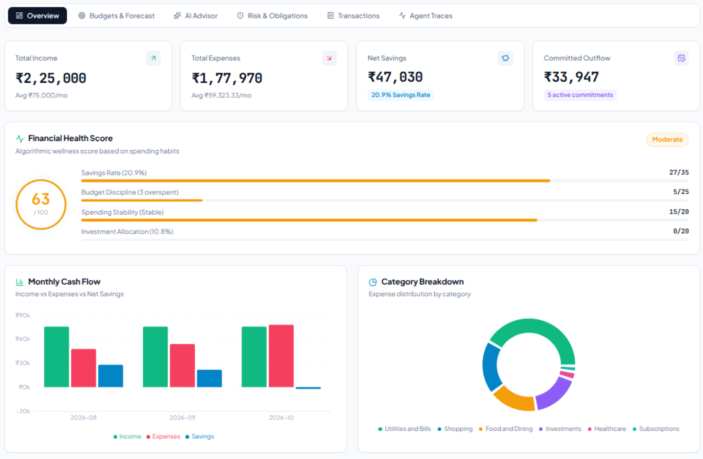
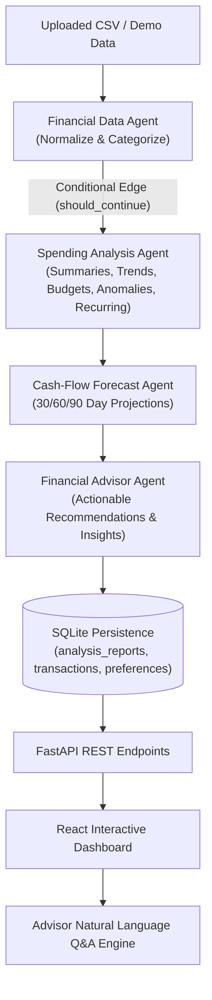

# Autonomous Personal Finance Agent

A multi-agent AI system for financial wellness and proactive expense management built with **FastAPI**, **LangGraph**, **React**, and **SQLite**.



## Key Features

- **Coordinated LangGraph Multi-Agent Architecture**:
  - **Financial Data Agent**: Transaction validation, schema normalization to ISO-8601, and hybrid categorization (deterministic regex rules across 11 financial domains + LLM ambiguity classification + confidence metric).
  - **Spending Analysis Agent**: Computes temporal aggregations, month-over-month trend changes, dynamic budget tracking, statistical anomaly detection (Z-scores + duplicate charges), recurring subscription cadence detection, and a 0–100 indicative financial health score.
  - **Cash-Flow Forecast Agent**: Projects daily/monthly balance trajectories over 30, 60, and 90-day horizons with shortfall warnings against safety reserve thresholds.
  - **Financial Advisor Agent**: Synthesizes verified findings into prioritized recommendations with calculated monthly and annual ₹ savings impact, plus an interactive natural-language chat copilot.
- **Glass-Box Multi-Agent Observability**:
  - Live execution traces capturing agent reasoning steps, structured decisions, state diff keys, execution latency in milliseconds, and underlying LLM token usage.
- **Modern Interactive Dashboard (6 Specialized Views)**:
  - **Overview**: Core financial KPIs (Total Income, Total Expenses, Net Savings, Recurring outflow), Financial Health gauge, category breakdown donut, monthly trends, and prioritized action plan.
  - **Budgets & Forecast**: Dynamic category budget sliders with immediate re-analysis, and 90-day cash flow projection milestone graph.
  - **AI Advisor**: Context-grounded conversational copilot with query shortcuts for interactive financial interrogation.
  - **Risk & Obligations**: Statistical anomaly detector and recurring payment/subscription auditor.
  - **Transactions**: Filterable and searchable normalized transaction register.
  - **Agent Traces**: Full glass-box inspection panel for agent decisions and LLM prompts.
- **Dual-LLM Resilience & Deterministic Fallbacks**:
  - Primary low-latency reasoning via **Groq** (`llama-3.3-70b-versatile`) and strategic synthesis via **Google Gemini** (`gemini-2.0-flash` / `gemini-1.5-flash`).
  - High-fidelity offline fallbacks ensure zero downtime even without API keys.

---

## Architecture



---

## Getting Started

### 1. Prerequisites
- **Python 3.10+** (tested on Python 3.12)
- **Node.js 18+** & **npm**

### 2. Backend Setup

```bash
# Create and activate virtual environment
python3 -m venv backend/venv
source backend/venv/bin/activate

# Install all backend dependencies
pip install -r backend/requirements.txt

# (Optional) Configure LLM API Keys in .env:
# GROQ_API_KEY=gsk_...
# GEMINI_API_KEY=AIza...
# If keys are omitted, the system seamlessly operates in deterministic offline simulation mode.

# Run the API server
uvicorn backend.app.main:app --host 0.0.0.0 --port 8000 --reload
```

The API will be available at `http://localhost:8000`. Interactive OpenAPI documentation is accessible at `http://localhost:8000/docs`.

### 3. React Frontend Setup

The frontend is a Single Page Application built with **React 18**, **Vite**, **Recharts**, and **Lucide Icons**:

```bash
cd frontend

# Install node dependencies
npm install

# Run React Vite Development Server (with hot module replacement)
npm run dev

# Or compile production bundle
npm run build
```

- **React Vite Dev Server:** `http://localhost:5173` (proxies `/api` requests to backend at `http://localhost:8000`)
- **Production Server:** `http://localhost:8000` (FastAPI automatically serves compiled assets from `frontend/dist/` when built)

---

## Running Tests

### Unit & Integration Tests (Pytest)
Exercises merchant taxonomy classification, the 4-agent LangGraph workflow, arithmetic invariants, and REST API endpoints:
```bash
PYTHONPATH=. backend/venv/bin/pytest tests/test_backend.py
```

### End-to-End Playwright Tests
Automates headless browser testing across all dashboard tabs, interactive chat, budget updates, and trace views:
```bash
PYTHONPATH=. backend/venv/bin/pytest tests/test_frontend_playwright.py
```

---

## API Endpoints

| Method | Endpoint | Description |
| :--- | :--- | :--- |
| `GET` | `/api/health` | Health check endpoint returning service status and version |
| `GET` | `/api/config/llm` | Active LLM configuration status for Groq and Gemini providers |
| `GET` | `/api/reports/latest` | Fetch the most recent financial analysis report (auto-generates sample data if empty) |
| `GET` | `/api/reports/{report_id}` | Retrieve a specific historical report by unique ID |
| `POST` | `/api/upload` | Upload and analyze a custom transaction CSV file |
| `POST` | `/api/analyze-sample` | Reset and analyze the built-in realistic 3-month demo dataset |
| `GET` | `/api/transactions` | Query categorized transactions with optional `category` and `search` filters |
| `POST` | `/api/chat` | Conversational context-grounded Q&A with the Financial Advisor Agent |
| `GET` | `/api/preferences` | Retrieve current user spending limits, minimum reserve threshold, and savings goal |
| `POST` | `/api/preferences` | Update category budgets and thresholds; triggers automatic re-analysis of latest report |
