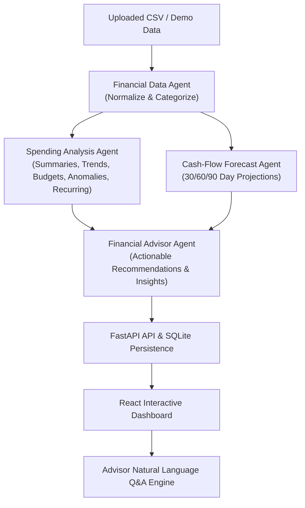

# Autonomous Personal Finance Agent

A multi-agent AI system for financial wellness and proactive expense management built with **FastAPI**, **LangGraph**, **React**, and **SQLite**.


## Key Features

- **Coordinated LangGraph Multi-Agent Architecture**:
  - **Financial Data Agent**: Transaction validation, column normalization, and hybrid categorization (merchant rules + confidence metrics).
  - **Spending Analysis Agent**: Computes monthly income, expenses, category aggregates, month-over-month trend changes, budget utilization, anomaly detection (statistical outliers + duplicate charges), recurring payments, and a 0-100 indicative financial health score.
  - **Cash-Flow Forecast Agent**: Projects daily/monthly balance trajectories over 30, 60, and 90-day horizons with shortfall warnings against safety thresholds.
  - **Financial Advisor Agent**: Synthesizes verified findings into prioritized recommendations with calculated ₹ savings impact, plus an interactive natural-language chat interface.
- **Interactive Modern Dashboard**:
  - Key financial metrics (Total Income, Total Expenses, Net Savings, Recurring outflow).
  - Financial Health Score gauge with transparent breakdown.
  - Category Donut Chart & Monthly Cash-Flow Trend Bar Chart.
  - Dynamic Budget Tracker with adjustable spending thresholds.
  - Anomaly & Recurring Obligations Monitor with review capabilities.
  - 90-Day Cash Flow projection with milestone tracking.
  - Filterable & searchable normalized transaction register.

---

## Architecture



---

## Getting Started

### 1. Backend Setup

```bash
# Create and activate virtual environment
python3 -m venv backend/venv
source backend/venv/bin/activate

# Install dependencies
pip install fastapi uvicorn pandas pydantic python-multipart langgraph pytest playwright httpx

# Run the API server
uvicorn backend.app.main:app --host 0.0.0.0 --port 8000
```

The API will be available at `http://localhost:8000`.

### 2. React Frontend Setup

The frontend is a dedicated React SPA built with **React 18**, **Vite**, **Recharts**, and **Lucide Icons**:

```bash
cd frontend

# Install node dependencies
npm install

# Run React Vite Development Server (with hot module replacement)
npm run dev

# Or compile production bundle
npm run build
```

- **React Vite Dev Server:** `http://localhost:5173` (proxies `/api` requests to backend at `http://localhost:8000`)
- **Production URL:** `http://localhost:8000` (FastAPI serves compiled React assets)

---

## Running Tests

### Unit & Integration Tests (Pytest)
```bash
PYTHONPATH=. backend/venv/bin/pytest tests/test_backend.py
```

### End-to-End Playwright Tests
```bash
PYTHONPATH=. backend/venv/bin/pytest tests/test_frontend_playwright.py
```

---

## API Endpoints

- `GET /api/health` - Service health status
- `GET /api/reports/latest` - Fetch the latest financial analysis report
- `POST /api/upload` - Upload a new transaction CSV file
- `POST /api/analyze-sample` - Reset and analyze the built-in realistic 3-month demo dataset
- `GET /api/transactions` - List categorized transactions with category and search query filters
- `POST /api/chat` - Conversational Q&A with the Financial Advisor Agent
- `POST /api/preferences` - Update category budgets and balance thresholds
